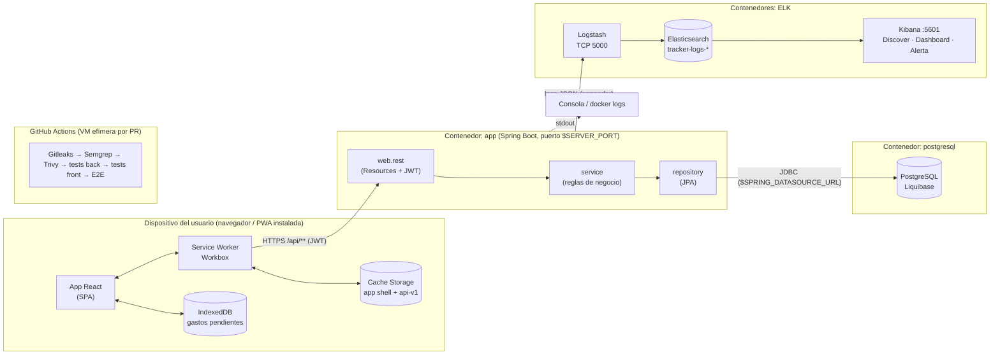

# Arquitectura

Decisiones: ADR-0001 a ADR-0007. Este documento muestra **cómo encajan las piezas**.

## 1. Diagrama de despliegue

## 2. Subsistemas

| Subsistema | Responsabilidad | Spec |
|---|---|---|
| Gastos y categorías | CRUD, validación, propiedad de los datos | 001 |
| Resumen | Cálculo mensual por categoría y variación | 002 |
| Offline (cliente) | Service worker, caché, pendientes, sincronización | 003 |
| Observabilidad | Eventos estructurados, centralización, dashboard, alerta | 004 |
| Seguridad | JWT, roles, control de acceso por dueño | 001 (transversal) |
| Entrega | Pipeline de verificación | 005 |

## 3. Checklist de arquitectura

| Aspecto | Decisión |
|---|---|
| **Persistencia** | JPA/Hibernate (ORM) sobre PostgreSQL en todos los entornos. Esquema versionado con Liquibase. Escrituras con `@Transactional`. Se persisten gastos, categorías y usuarios; el resumen se calcula al pedirlo (no se guarda). En el cliente: IndexedDB solo para pendientes |
| **Concurrencia y transacciones** | Una transacción por operación. No hay edición concurrente del mismo gasto (cada gasto tiene un solo dueño), así que no hace falta bloqueo optimista |
| **UI** | React, responsive y mobile first (360 px), instalable como PWA |
| **Rendimiento** | Montos en `BigDecimal` (exactos) con `NUMERIC` en la base. Listado paginado. Sin caché de servidor (`cacheProvider no`): el volumen no lo justifica. Caché de cliente con Workbox |
| **Distribución** | Build con Maven + npm. CI en GitHub Actions. Imagen con Jib. Configuración por variables de entorno (12 factors) |
| **Seguridad** | JWT stateless, roles `USER`/`ADMIN`, propiedad de gastos verificada en el backend (ADR-0007), controles en el CI |
| **Monitoreo** | Logs JSON → ELK, `traceId` por petición, dashboard de salud y alerta por logins fallidos |
| **Testing** | Unitarios, integración con Testcontainers, ArchUnit, Vitest y E2E con Playwright |

## 4. Entornos

| Entorno | App | Base | Logs |
|---|---|---|---|
| dev | `./mvnw` + `npm start` | Postgres en Docker (se levanta solo) | Consola; ELK opcional con `elk.yml` |
| test / CI | Testcontainers / jar `e2e` | Postgres en contenedor | Consola |
| prod (demo) | Imagen Jib con `app.yml` | Postgres en contenedor con volumen | ELK |
